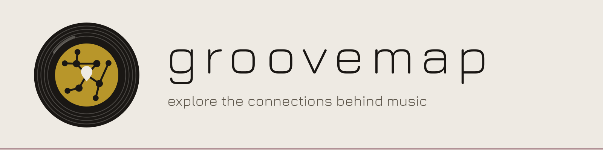

<picture>
  <source media="(prefers-color-scheme: dark)" srcset="./assets/banner-dark.svg">
  <source media="(prefers-color-scheme: light)" srcset="./assets/banner-light.svg">
  
</picture>

# Explore the connections behind music

[GrooveMap](https://groovemap.music) turns music-catalog data into a connected map of
artists, labels, releases, credits, and the relationships between them.

## What we are building

- [Graph Explorer](https://github.com/groovemap-music/graph-explorer) is the
  public-facing graph exploration application and API proxy.
- [Catalog API](https://github.com/groovemap-music/catalog-api) provides authentication,
  catalog search, graph queries, recommendations, analytics, and operator endpoints.
- [MCP Server](https://github.com/groovemap-music/mcp-server) connects compatible AI
  clients to GrooveMap through the catalog API.
- [GrooveMap on the web](https://groovemap.music) is the canonical project website and
  documentation entry point.

## Run GrooveMap yourself

GrooveMap can run on your own hardware. The [homelab guide](https://github.com/groovemap-music/deployment/blob/main/docs/homelab.md) covers requirements, setup, and upgrades, and the [deployment README](https://github.com/groovemap-music/deployment/blob/main/README.md#run-groovemap-in-your-homelab) has the quick start. In Claude Code, an AI agent can set it up for you:

```text
/plugin marketplace add groovemap-music/deployment
/plugin install groovemap-homelab@groovemap
```

## Public project repositories

GrooveMap maintains 21 repositories: the 19 public implementation and documentation repositories
below, plus 2 private boundaries, `infra` and `planning-archive`. This inventory and its
descriptions are sourced from the immutable
[`design` catalog](https://github.com/groovemap-music/design/blob/41be7cbe738f40df0c75ad7065475e91d6cc2aa4/catalog/repositories.json).

| Repository | Purpose |
| --- | --- |
| [`.github`](https://github.com/groovemap-music/.github) | GrooveMap organization profile and shared community-health files. |
| [`analytics-engine`](https://github.com/groovemap-music/analytics-engine) | Scheduled and precomputed music analytics with PostgreSQL and Valkey caching. |
| [`automation`](https://github.com/groovemap-music/automation) | Reusable GitHub Actions workflows and composite actions for GrooveMap repositories. |
| [`catalog-api`](https://github.com/groovemap-music/catalog-api) | GrooveMap authentication, catalog search, graph query, recommendation, analytics, and operator API. |
| [`database-schema`](https://github.com/groovemap-music/database-schema) | Versioned Neo4j and PostgreSQL schemas, runnable initialization, and compatibility contracts. |
| [`deployment`](https://github.com/groovemap-music/deployment) | Whole-stack Compose topology, production hardening, runtime configuration promotion, and deployment validation. |
| [`design`](https://github.com/groovemap-music/design) | GrooveMap brand sources, public architecture decisions, repository catalog, and canonical media taxonomy. |
| [`discogs-graph-enricher`](https://github.com/groovemap-music/discogs-graph-enricher) | Consumes Discogs events and constructs the Neo4j music knowledge graph. |
| [`discogs-ingestion`](https://github.com/groovemap-music/discogs-ingestion) | Downloads, verifies, parses, and normalizes Discogs dumps, then publishes source-owned events. |
| [`discogs-sql-loader`](https://github.com/groovemap-music/discogs-sql-loader) | Consumes Discogs events and builds PostgreSQL analytical tables. |
| [`graph-explorer`](https://github.com/groovemap-music/graph-explorer) | Public-facing GrooveMap graph-exploration web application and catalog API proxy. |
| [`groovemap-music.github.io`](https://github.com/groovemap-music/groovemap-music.github.io) | Static Astro organization website for groovemap.music. |
| [`mcp-server`](https://github.com/groovemap-music/mcp-server) | Client-run Model Context Protocol integration exposing GrooveMap through the catalog API. |
| [`musicbrainz-graph-enricher`](https://github.com/groovemap-music/musicbrainz-graph-enricher) | Consumes MusicBrainz events and enriches matched Neo4j entities. |
| [`musicbrainz-ingestion`](https://github.com/groovemap-music/musicbrainz-ingestion) | Downloads and verifies MusicBrainz dumps, enriches normalized JSONL, and publishes source-owned events. |
| [`musicbrainz-sql-loader`](https://github.com/groovemap-music/musicbrainz-sql-loader) | Consumes MusicBrainz events and loads the complete dataset into PostgreSQL. |
| [`operations-console`](https://github.com/groovemap-music/operations-console) | Privileged GrooveMap administration and monitoring web console. |
| [`operations-toolkit`](https://github.com/groovemap-music/operations-toolkit) | Credential-conscious, primarily observational queue, error, system, and deployment command-line utilities. |
| [`python-libraries`](https://github.com/groovemap-music/python-libraries) | Versioned Python runtime, resilience, and agent-tool libraries shared by GrooveMap services. |

The public catalog excludes operational credentials and private recovery evidence. Only `infra`,
which owns organization infrastructure and policy, and `planning-archive`, which preserves
historical planning records, remain private.

Organization conventions and shared workflow documentation are indexed in the
[`.github` repository docs](../docs/README.md).
